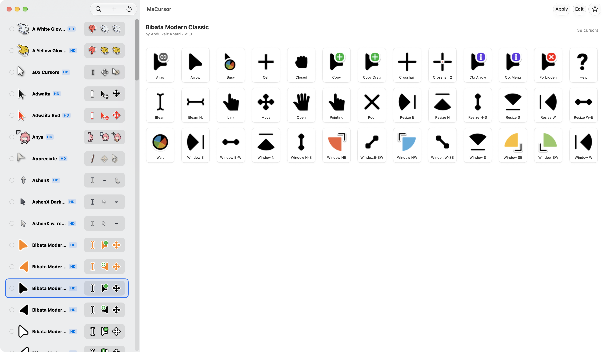

<div align="center">


# MaCursor

**Cursor Control for macOS**

[](https://github.com/writronic/MaCursor/releases/latest)


[](LICENSE)
[](https://github.com/sponsors/writronic)

</div>

---

MaCursor gives you control over system cursors on macOS. You can replace macOS cursors with your own artwork or with ready-made themes, fine-tune every detail in the visual editor, and switch between them instantly with global hotkeys.

Requires **macOS 13 Ventura** or later.

<p align="center">
  
</p>

## Features

- **80+ Ready-to-Apply Themes** — Browse and download curated cursor themes from the Theme Gallery
- **Menu Bar Panel** — Your favorite themes, the cursor for the app in front, and the cursor scale, Cursor Shadow, Focus on Hover, Cursor Shaker, Cursor Translator, Cursor Gestures and Cursor Trails controls, all in the menu bar without opening the window
- **Right-Click Menu** — Get more from your right-click in Finder and on the Desktop: copy a path, make a new file, open files in the app you choose, and more
- **Focus on Hover** — The window under your pointer becomes active after a short pause, without clicking
- **Cursor Capture** — Press a shortcut to take a picture of your screen, an area or a window, with your cursor in it if you want. Mark it up in an editor, or copy the text in it
- **Cursor Translator** — A frame over any text on your screen shows it in your language, and keeps up as the text changes
- **Cursor Gestures** — Hold modifier keys or a mouse button and draw a shape to run an action, such as a keyboard shortcut, typed text, an app, a website or a window action
- **Cursor Trails** — A smooth line follows your pointer and shrinks back into it when you stop, in ready-to-use styles
- **Per-App Themes** — Each app can have its own cursor theme, and MaCursor switches to it when that app comes to the front
- **Convert Windows, Linux & Mousecape Themes** — A Windows cursor folder (`.cur` / `.ani`), a Linux Xcursor theme folder or a Mousecape `.cape` file becomes a native `.cursor` theme, with every mapped cursor listed for review before it reaches your library
- **Full Theme Editor** — A split-pane editor for building and refining themes: metadata, cursor list, per-cursor image slots, hotspot editing, and animated cursor preview
- **Cursor Scale** — Adjust cursor size from 0.50× to 4.00× with a precision slider (0.1× steps), or type any custom value and press Enter to apply
- **Left / Right Hand Mode** — Cursor orientation for left-handed or right-handed mouse use

<details>
<summary><b>Full feature list</b>: 15 more, including the editor tools, the app languages, and macOS Tahoe support</summary>

### Applying & Switching

- **One-Click Apply** — One double-click on a theme replaces every system cursor
- **Global Hotkeys** — Assign keyboard shortcuts to favorite themes for instant switching from anywhere
- **Theme Automation** — Your cursor changes itself on a Day and Night schedule, or follows the system appearance and switches with Light and Dark mode

### Editor

- **Live Hotspot Editor** — You place the click point on the cursor image itself, and the X / Y values update as the marker moves
- **Live Preview** — A preview strip that turns your real pointer into the cursor you're editing, marks where it actually clicks, and shows it against black and white side by side
- **Animated GIF Import** — An animated `.gif` dropped on a cursor slot becomes a sprite sheet, with its frame timing worked out for you
- **HiDPI / Retina Support** — Separate 1× and 2× image representations per cursor for crisp rendering on Retina displays
- **Upscale** — Cursors that have only a 1× image get a sharp 2× image when you import or convert a theme

### Appearance & Interface

- **Cursor Shadow** — A soft shadow under the pointer
- **Light / Dark / System Appearance** — Full appearance mode control
- **11 Languages** — English, Deutsch, Español, Français, Nederlands, Polski, Русский, Türkçe, 日本語, 简体中文, العربية

### System

- **Background Helper Tool** — Lightweight login item (`MaCursorHelper`) that keeps shortcuts active and reapplies your theme across user switches
- **Auto-Updates** — Built-in Sparkle integration for over-the-air updates
- **macOS Tahoe & Golden Gate Ready** — Full support for macOS 26 Tahoe and macOS 27 Golden Gate, including automatic handling of new S-variant cursor identifiers
- **Cursor Shaker** — While you are away, your pointer moves one pixel and back, and the display stays on, so apps like Slack and Microsoft Teams keep showing you as active

</details>

## Quick Start

Get up and running in under a minute:

### 1. Install MaCursor

Download the latest `.dmg` from the [Releases page](https://github.com/writronic/MaCursor/releases/latest), open it, and drag MaCursor to your Applications folder.

Or install it with [Homebrew](https://brew.sh):

```bash
brew install --cask writronic/tap/macursor
```

### 2. Welcome Window

The first time you open MaCursor, the Welcome window walks you through the setup. Install the Helper Tool on its first page, and choose **Grant Permission** wherever a feature needs access. If you quit before you finish, it opens again the next time you launch the app.

### 3. Get Themes

Browse `.cursor` theme files in the [Theme Gallery](https://github.com/writronic/MaCursor/blob/main/themes/README.md) or grab them all from the [Releases page](https://github.com/writronic/MaCursor/releases/latest). Already have a Windows or Linux cursor theme? Use **File → Convert Theme…** instead.

### 4. Import & Apply

Double-click any `.cursor` file, drag & drop it onto the MaCursor library window, or use **File → Import Theme…**. Then select the theme and click **Apply**.

### 5. Make It Permanent (Recommended)

Without the helper tool, cursors reset after a restart or user switch. To keep your theme active permanently:

1. Open **MaCursor → Settings → General**.
2. Click **Install** next to **Helper Tool**.
3. That's it — the helper runs silently at login and reapplies your theme automatically.

> [!IMPORTANT]
> The helper tool is a lightweight login item. It uses minimal resources and keeps your chosen cursor theme across restarts, sleep/wake cycles, and user switches.

## Install

Download the latest `.dmg` from the [Releases page](https://github.com/writronic/MaCursor/releases/latest). The app ships as a **universal binary** (Apple Silicon + Intel). Every release is **code-signed, notarized, and stapled** by Apple.

## Usage

Read the [user guides](docs/README.md) for every feature, and [Troubleshooting and FAQ](docs/troubleshooting.md) when something does not work.

## Development

### Build from Source

1. Clone the repository:
   ```sh
   git clone https://github.com/writronic/MaCursor.git
   cd MaCursor/Project
   ```
2. Open `MaCursor.xcodeproj` in Xcode 16+.
3. Build and run the **MaCursor** scheme.

> [!NOTE]
> MaCursor uses [Sparkle](https://sparkle-project.org) via Swift Package Manager. Xcode resolves the dependency automatically on first open.

## Contributing

Contributions are welcome! Please read [CONTRIBUTING.md](.github/CONTRIBUTING.md) before getting started.

### Bug Reports & Feature Requests

Search existing issues before opening a new one. Use the Bug Report or Feature Request template to ensure your report includes all necessary details.

### Localization

MaCursor supports 11 languages. Translation files are located in `MaCursor/Resources/l10n/` — each language has its own `.lproj/Localizable.strings` file. Pull requests for new or improved translations are welcome.

### Cursor Themes

Created a theme you'd like to share? Submit it to the built-in gallery — see the [contributing guide](.github/CONTRIBUTING.md#submitting-a-theme-to-the-gallery) for instructions.

### Code

Fork the repository, create a feature branch, and open a pull request. Please follow the [pull request template](.github/PULL_REQUEST_TEMPLATE.md) and keep changes focused.

## Credits

[Mousecape](https://github.com/alexzielenski/Mousecape)

## License

MaCursor is available under the [GPL-3.0 license](LICENSE).

---

<div align="center">

**Made with ❤️ by Writronic**

</div>