

# Theme Gallery

**Browse 100+ cursor themes — click any name to download, or grab them all from the [Releases page](https://github.com/writronic/MaCursor/releases/latest).**

---

### [A0xCursors](https://github.com/writronic/MaCursor/blob/main/themes/A0xCursors.cursor)

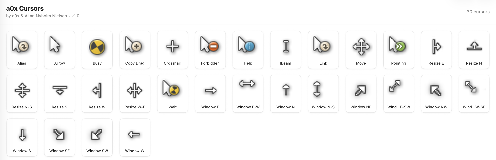

*Created by [a0x](https://www.deviantart.com/a0x/art/a0x-curset-1-63330985), port by [allannyholm](https://www.deviantart.com/allannyholm/art/Mousecape-Throwback-2021-Mac-cursors-781872368)*

---

### [AWhiteGloveCursor](https://github.com/writronic/MaCursor/blob/main/themes/AWhiteGloveCursor.cursor)

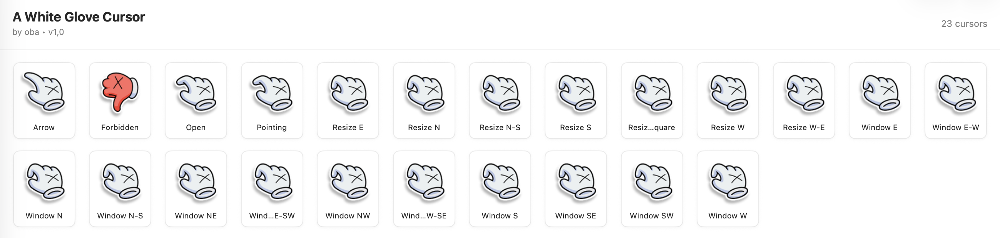

*Created by obatola ([GitHub](https://github.com/obatola/mousecape-hand-cursor))*

---

### [AYellowGloveCursor](https://github.com/writronic/MaCursor/blob/main/themes/AYellowGloveCursor.cursor)

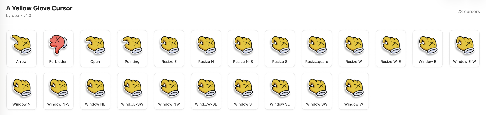

*Created by obatola ([GitHub](https://github.com/obatola/mousecape-hand-cursor))*

---

### [Adwaita](https://github.com/writronic/MaCursor/blob/main/themes/Adwaita.cursor)

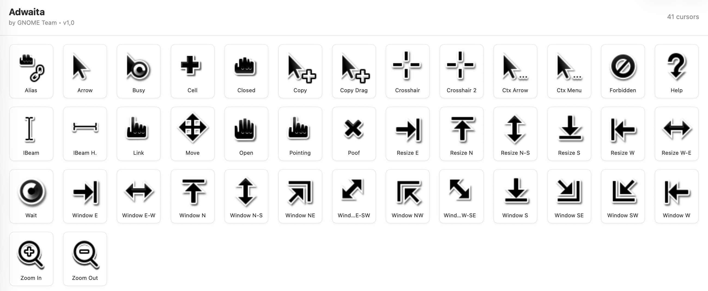

*Created by the GNOME Project ([GitLab](https://gitlab.gnome.org/GNOME/adwaita-icon-theme-legacy))*

---

### [AdwaitaRed](https://github.com/writronic/MaCursor/blob/main/themes/AdwaitaRed.cursor)

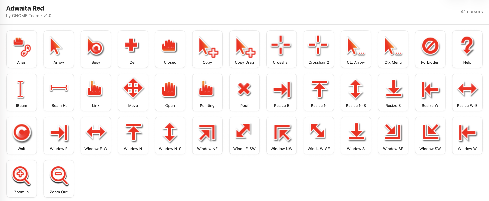

*Created by the GNOME Project ([GitLab](https://gitlab.gnome.org/GNOME/adwaita-icon-theme-legacy))*

---

### [alex](https://github.com/writronic/MaCursor/blob/main/themes/alex.cursor)

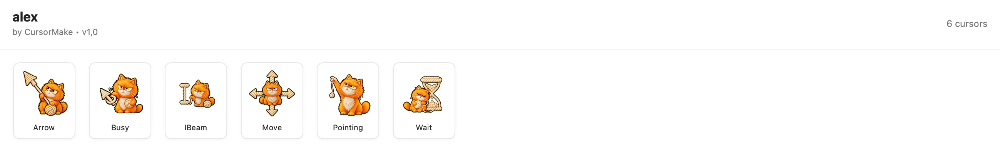

*Created by [CursorMake](https://cursormake.com/cursors/alex/)*

---

### [Anya](https://github.com/writronic/MaCursor/blob/main/themes/Anya.cursor)

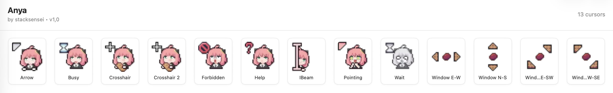

*Created by Moos柚眠, port by [Uyukisan](https://github.com/Uyukisan/mousecape-Anya)*

---

### [Appreciate](https://github.com/writronic/MaCursor/blob/main/themes/Appreciate.cursor)

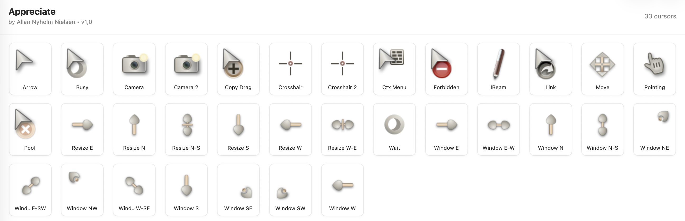

*Created by allannyholm ([DeviantArt](https://www.deviantart.com/allannyholm/art/Appreciate-cursors-717626229))*

---

### [AshenX](https://github.com/writronic/MaCursor/blob/main/themes/AshenX.cursor)

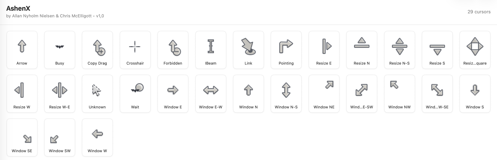

*Created by allannyholm ([DeviantArt](https://www.deviantart.com/allannyholm))*

---

### [AshenXDarkWRegularArrow](https://github.com/writronic/MaCursor/blob/main/themes/AshenXDarkWRegularArrow.cursor)

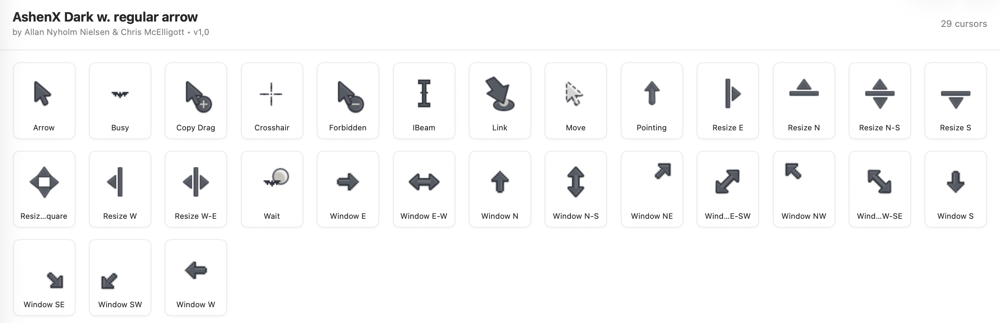

*Created by allannyholm ([DeviantArt](https://www.deviantart.com/allannyholm))*

---

### [AshenXWRegularArrow](https://github.com/writronic/MaCursor/blob/main/themes/AshenXWRegularArrow.cursor)

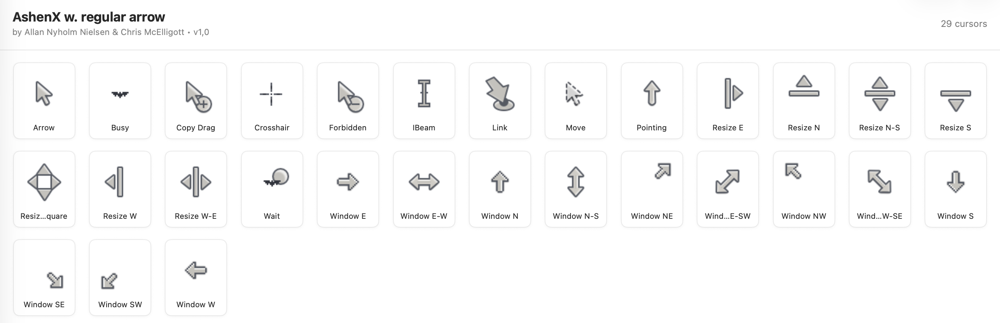

*Created by allannyholm ([DeviantArt](https://www.deviantart.com/allannyholm))*

---

### [BibataModernAmber](https://github.com/writronic/MaCursor/blob/main/themes/BibataModernAmber.cursor)

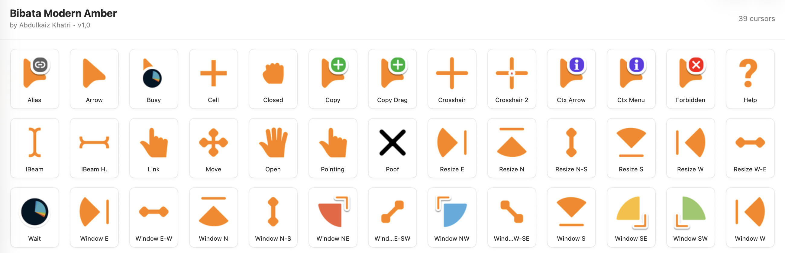

*Created by ful1e5 ([GitHub](https://github.com/ful1e5))*

---

### [BibataModernAmberRight](https://github.com/writronic/MaCursor/blob/main/themes/BibataModernAmberRight.cursor)

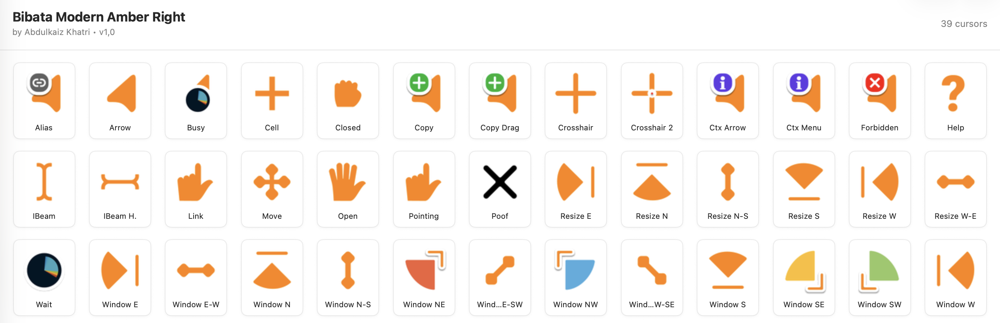

*Created by ful1e5 ([GitHub](https://github.com/ful1e5))*

---

### [BibataModernClassic](https://github.com/writronic/MaCursor/blob/main/themes/BibataModernClassic.cursor)

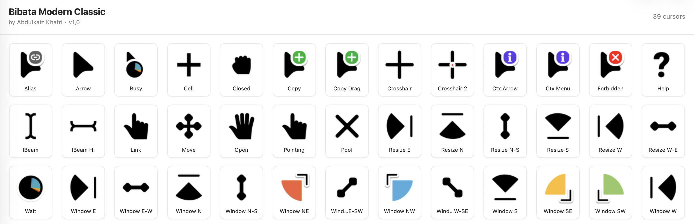

*Created by ful1e5 ([GitHub](https://github.com/ful1e5))*

---

### [BibataModernClassicRight](https://github.com/writronic/MaCursor/blob/main/themes/BibataModernClassicRight.cursor)

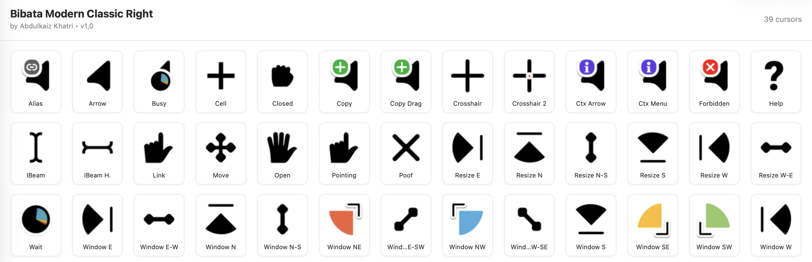

*Created by ful1e5 ([GitHub](https://github.com/ful1e5))*

---

### [BibataModernIce](https://github.com/writronic/MaCursor/blob/main/themes/BibataModernIce.cursor)

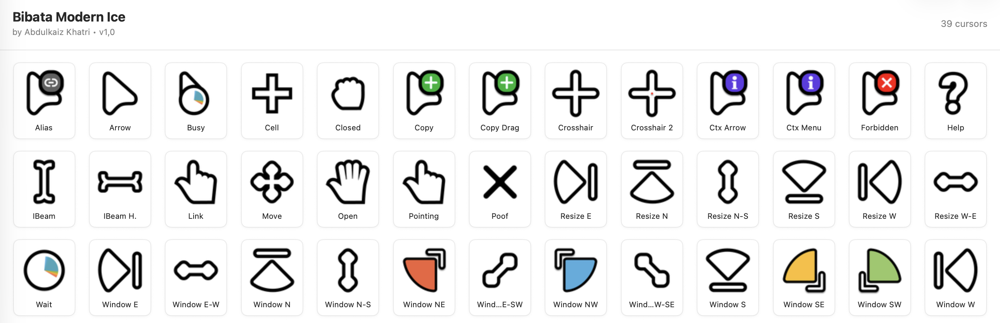

*Created by ful1e5 ([GitHub](https://github.com/ful1e5))*

---

### [BibataModernIceRight](https://github.com/writronic/MaCursor/blob/main/themes/BibataModernIceRight.cursor)

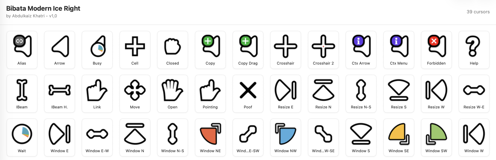

*Created by ful1e5 ([GitHub](https://github.com/ful1e5))*

---

### [BibataOriginalAmber](https://github.com/writronic/MaCursor/blob/main/themes/BibataOriginalAmber.cursor)

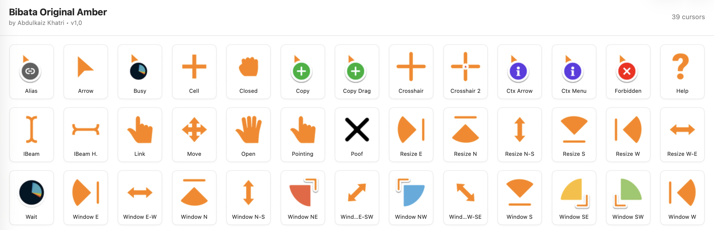

*Created by ful1e5 ([GitHub](https://github.com/ful1e5))*

---

### [BibataOriginalAmberRight](https://github.com/writronic/MaCursor/blob/main/themes/BibataOriginalAmberRight.cursor)

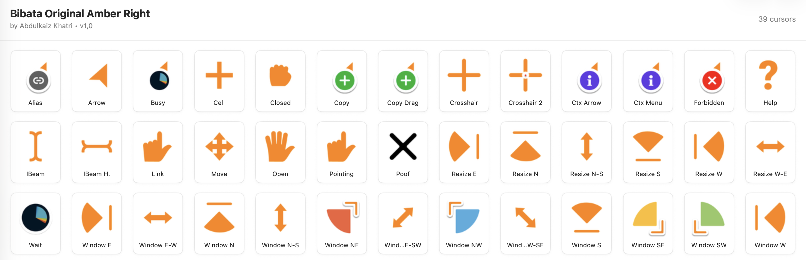

*Created by ful1e5 ([GitHub](https://github.com/ful1e5))*

---

### [BibataOriginalClassic](https://github.com/writronic/MaCursor/blob/main/themes/BibataOriginalClassic.cursor)

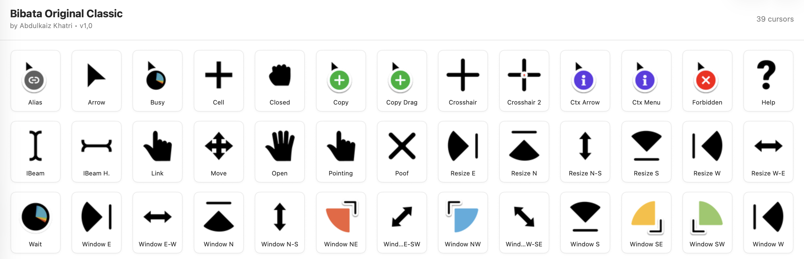

*Created by ful1e5 ([GitHub](https://github.com/ful1e5))*

---

### [BibataOriginalClassicRight](https://github.com/writronic/MaCursor/blob/main/themes/BibataOriginalClassicRight.cursor)

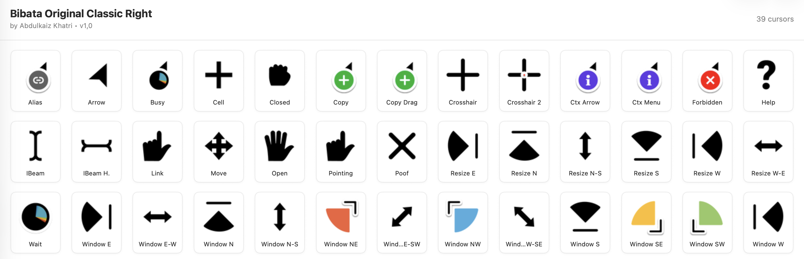

*Created by ful1e5 ([GitHub](https://github.com/ful1e5))*

---

### [BibataOriginalIce](https://github.com/writronic/MaCursor/blob/main/themes/BibataOriginalIce.cursor)

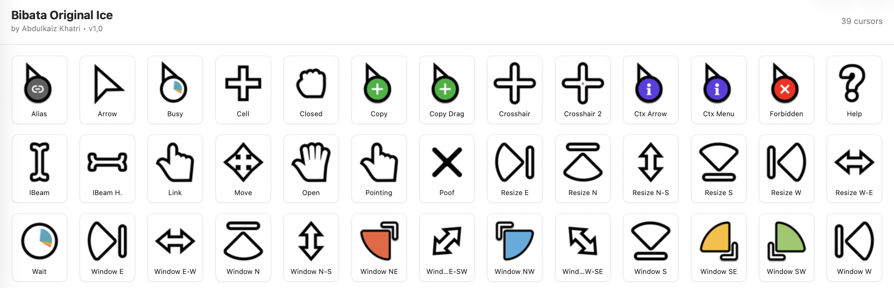

*Created by ful1e5 ([GitHub](https://github.com/ful1e5))*

---

### [BibataOriginalIceRight](https://github.com/writronic/MaCursor/blob/main/themes/BibataOriginalIceRight.cursor)

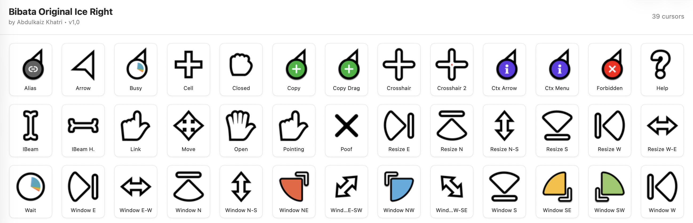

*Created by ful1e5 ([GitHub](https://github.com/ful1e5))*

---

### [BigHero6](https://github.com/writronic/MaCursor/blob/main/themes/BigHero6.cursor)

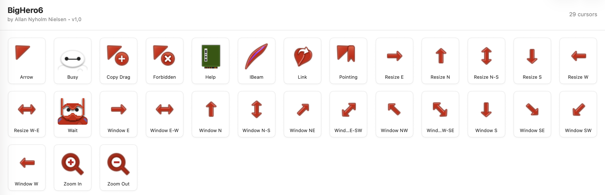

*Created by allannyholm ([DeviantArt](https://www.deviantart.com/allannyholm))*

---

### [Blau](https://github.com/writronic/MaCursor/blob/main/themes/Blau.cursor)

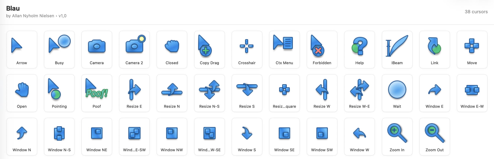

*Created by allannyholm ([DeviantArt](https://www.deviantart.com/allannyholm))*

---

### [Blau2](https://github.com/writronic/MaCursor/blob/main/themes/Blau2.cursor)

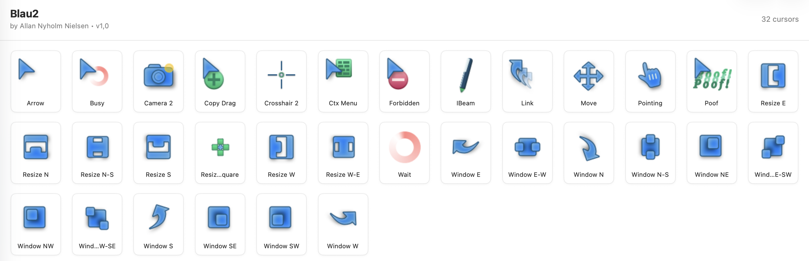

*Created by allannyholm ([DeviantArt](https://www.deviantart.com/allannyholm/art/Blau2MaintenanceMode-teaser-716592604))*

---

### [BreezeXBlack](https://github.com/writronic/MaCursor/blob/main/themes/BreezeXBlack.cursor)

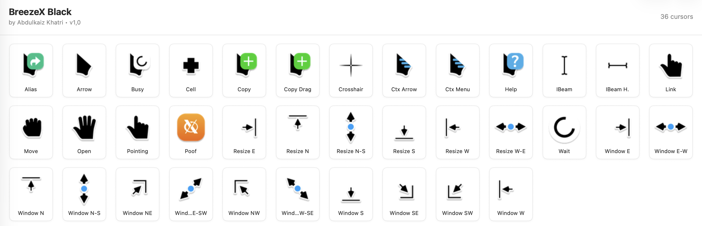

*Created by ful1e5 ([GitHub](https://github.com/ful1e5))*

---

### [BreezeXDark](https://github.com/writronic/MaCursor/blob/main/themes/BreezeXDark.cursor)

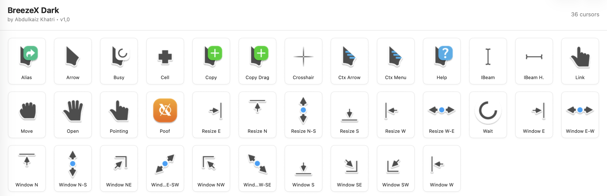

*Created by ful1e5 ([GitHub](https://github.com/ful1e5))*

---

### [BreezeXLight](https://github.com/writronic/MaCursor/blob/main/themes/BreezeXLight.cursor)

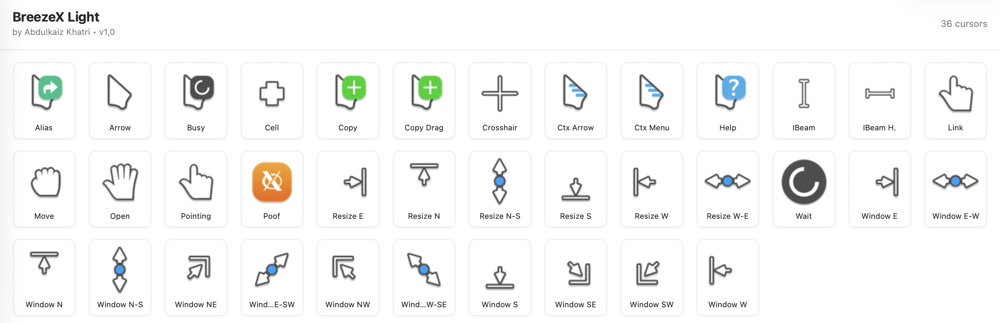

*Created by ful1e5 ([GitHub](https://github.com/ful1e5))*

---

### [CapitaineCursors](https://github.com/writronic/MaCursor/blob/main/themes/CapitaineCursors.cursor)

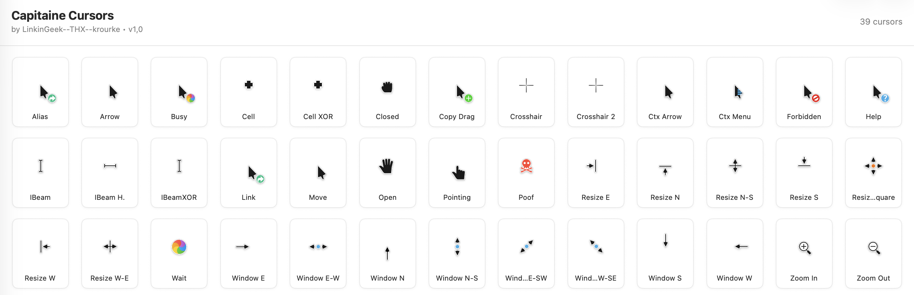

*Created by [keeferrourke](https://github.com/keeferrourke/capitaine-cursors), port by [linkingeek](https://www.deviantart.com/linkingeek/art/Capitaine-Cursors-988313515)*

---

### [CaptaineCursorsWhite](https://github.com/writronic/MaCursor/blob/main/themes/CaptaineCursorsWhite.cursor)

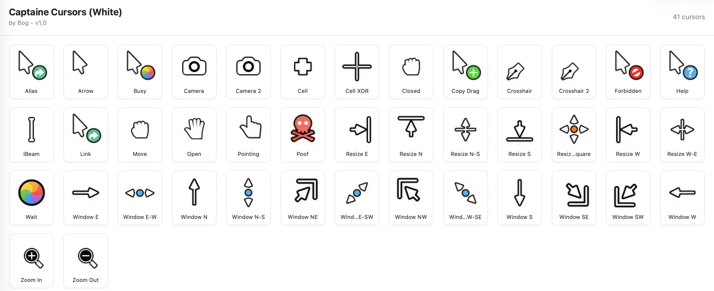

---

### [Cocoa](https://github.com/writronic/MaCursor/blob/main/themes/Cocoa.cursor)

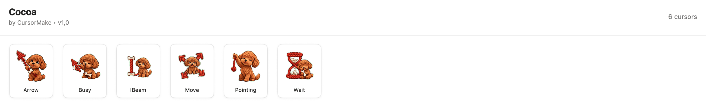

*Created by [CursorMake](https://cursormake.com/cursors/cocoa/)*

---

### [Empty-Butterfly-White](https://github.com/writronic/MaCursor/blob/main/themes/Empty-Butterfly-White.cursor)

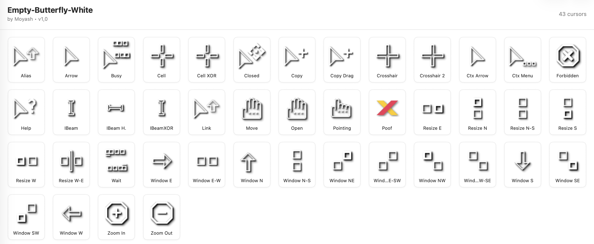

*Created by MOYASH77 ([DeviantArt](https://www.deviantart.com/moyash77/art/Empty-Butterfly-Magenta-Cursors-1069678799))*

---

### [FutureCursors](https://github.com/writronic/MaCursor/blob/main/themes/FutureCursors.cursor)

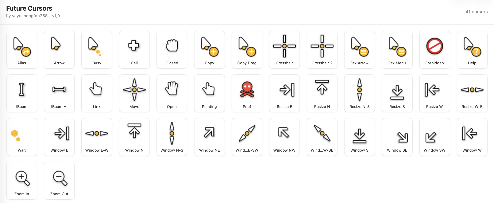

*Created by yeyushengfan258 ([GitHub](https://github.com/yeyushengfan258/Future-cursors))*

---

### [FutureCursorsBlack](https://github.com/writronic/MaCursor/blob/main/themes/FutureCursorsBlack.cursor)

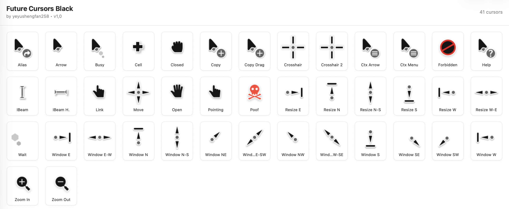

*Created by yeyushengfan258 ([GitHub](https://github.com/yeyushengfan258/Future-cursors))*

---

### [FutureCursorsCyan](https://github.com/writronic/MaCursor/blob/main/themes/FutureCursorsCyan.cursor)

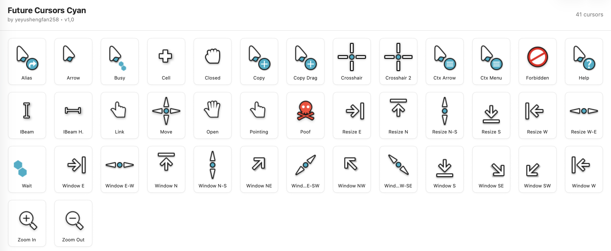

*Created by yeyushengfan258 ([GitHub](https://github.com/yeyushengfan258/Future-cursors))*

---

### [FutureCursorsDark](https://github.com/writronic/MaCursor/blob/main/themes/FutureCursorsDark.cursor)

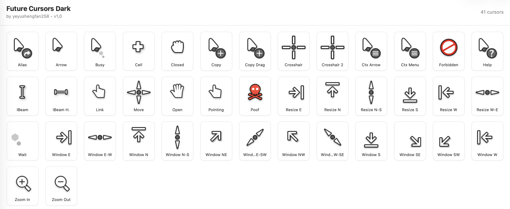

*Created by yeyushengfan258 ([GitHub](https://github.com/yeyushengfan258/Future-cursors))*

---

### [FutureTech](https://github.com/writronic/MaCursor/blob/main/themes/FutureTech.cursor)

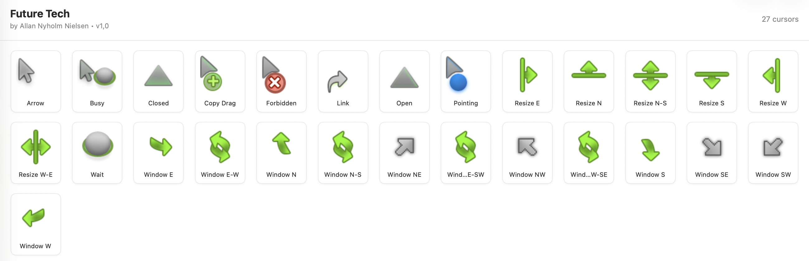

*Created by allannyholm ([DeviantArt](https://www.deviantart.com/allannyholm))*

---

### [Grove](https://github.com/writronic/MaCursor/blob/main/themes/Grove.cursor)

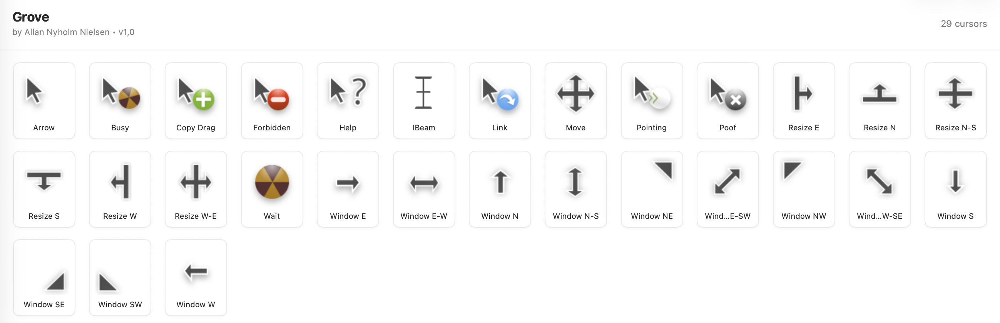

*Created by allannyholm ([DeviantArt](https://www.deviantart.com/allannyholm))*

---

### [Haand](https://github.com/writronic/MaCursor/blob/main/themes/Haand.cursor)

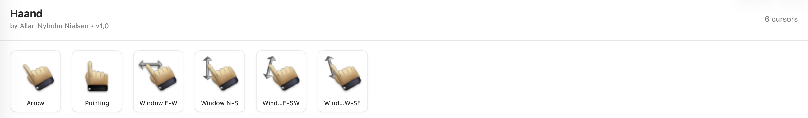

*Created by allannyholm ([DeviantArt](https://www.deviantart.com/allannyholm))*

---

### [Ignite](https://github.com/writronic/MaCursor/blob/main/themes/Ignite.cursor)

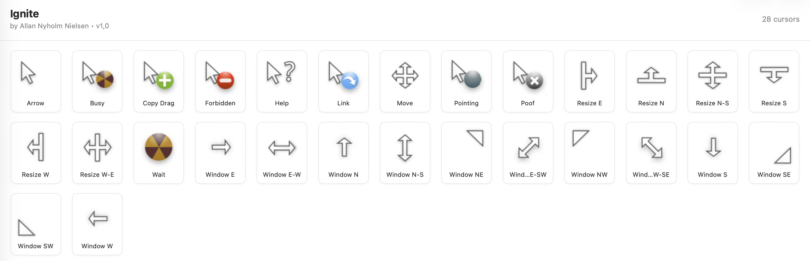

*Created by allannyholm ([DeviantArt](https://www.deviantart.com/allannyholm/art/Ignite-mousecape-hotspot-fix-update-735053168))*

---

### [KalTsit](https://github.com/writronic/MaCursor/blob/main/themes/KalTsit.cursor)

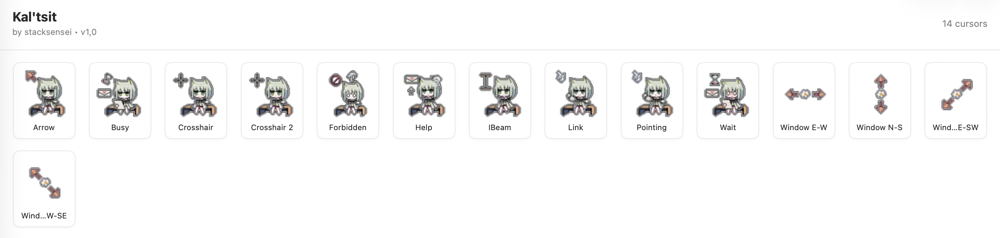

*Created by [Uyukisan](https://github.com/Uyukisan/mousecape-Anya)*

---

### [Klee](https://github.com/writronic/MaCursor/blob/main/themes/Klee.cursor)

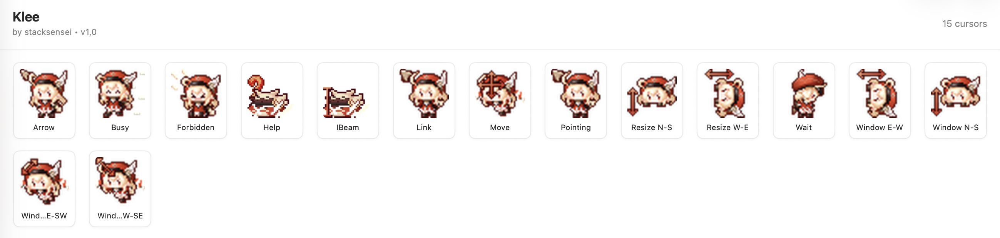

*Created by [Uyukisan](https://github.com/Uyukisan/mousecape-Anya)*

---

### [LuoXiaohei](https://github.com/writronic/MaCursor/blob/main/themes/LuoXiaohei.cursor)

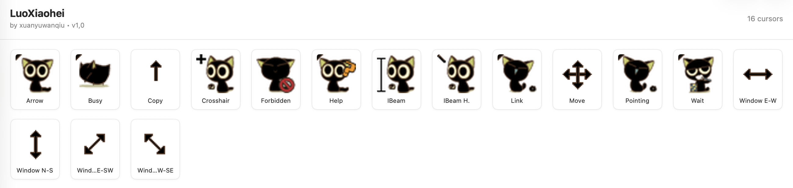

*Created by xuanyusan ([Gitee](https://gitee.com/xuanyusan/win2xcur_plus/blob/master/cape/com.xuanyusan.LuoXiaohei.cape))*

---

### [Luxus3](https://github.com/writronic/MaCursor/blob/main/themes/Luxus3.cursor)

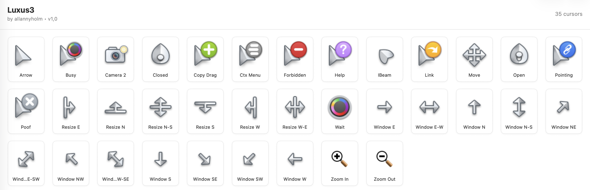

*Created by allannyholm ([DeviantArt](https://www.deviantart.com/allannyholm/art/Luxus3-Mousecape-updated-hotspot-849590582))*

---

### [Luxus3-Hand](https://github.com/writronic/MaCursor/blob/main/themes/Luxus3-Hand.cursor)

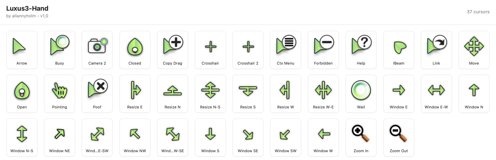

*Created by allannyholm ([DeviantArt](https://www.deviantart.com/allannyholm/art/GIN24Mousecape-edition-1049129101))*

---

### [Luxus3Gold](https://github.com/writronic/MaCursor/blob/main/themes/Luxus3Gold.cursor)

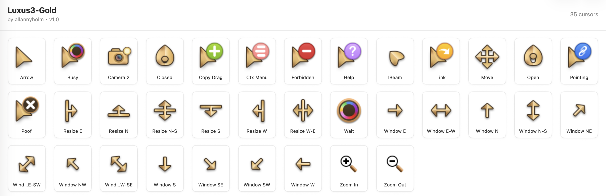

*Created by allannyholm ([DeviantArt](https://www.deviantart.com/allannyholm/art/Luxus3-Mousecape-updated-hotspot-849590582))*

---

### [Luxus3GoldDarkPlate](https://github.com/writronic/MaCursor/blob/main/themes/Luxus3GoldDarkPlate.cursor)

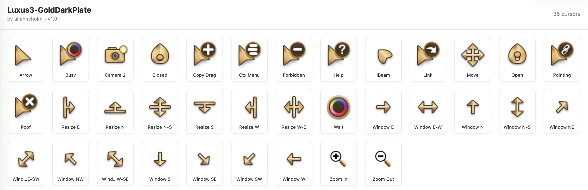

*Created by allannyholm ([DeviantArt](https://www.deviantart.com/allannyholm/art/Luxus3-Mousecape-updated-hotspot-849590582))*

---

### [Luxus3Obsidian](https://github.com/writronic/MaCursor/blob/main/themes/Luxus3Obsidian.cursor)

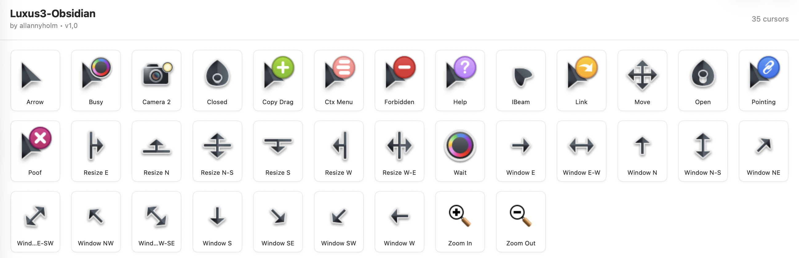

*Created by allannyholm ([DeviantArt](https://www.deviantart.com/allannyholm/art/Luxus3-Mousecape-updated-hotspot-849590582))*

---

### [Luxus3ObsidianDarkPlate](https://github.com/writronic/MaCursor/blob/main/themes/Luxus3ObsidianDarkPlate.cursor)

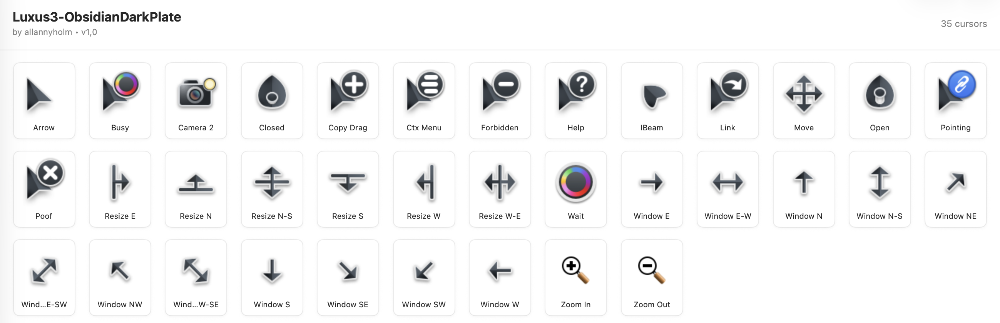

*Created by allannyholm ([DeviantArt](https://www.deviantart.com/allannyholm/art/Luxus3-Mousecape-updated-hotspot-849590582))*

---

### [Luxus3RoseDarkBadge](https://github.com/writronic/MaCursor/blob/main/themes/Luxus3RoseDarkBadge.cursor)

*Created by allannyholm ([DeviantArt](https://www.deviantart.com/allannyholm/art/Luxus3-Mousecape-added-pink-variant-849590582))*

---

### [Luxus3RoseLightBadge](https://github.com/writronic/MaCursor/blob/main/themes/Luxus3RoseLightBadge.cursor)

*Created by allannyholm ([DeviantArt](https://www.deviantart.com/allannyholm/art/Luxus3-Mousecape-added-pink-variant-849590582))*

---

### [LyraB](https://github.com/writronic/MaCursor/blob/main/themes/LyraB.cursor)

*Created by yeyushengfan258 ([GitHub](https://github.com/yeyushengfan258/Lyra-Cursors))*

---

### [LyraF](https://github.com/writronic/MaCursor/blob/main/themes/LyraF.cursor)

*Created by yeyushengfan258 ([GitHub](https://github.com/yeyushengfan258/Lyra-Cursors))*

---

### [LyraG](https://github.com/writronic/MaCursor/blob/main/themes/LyraG.cursor)

*Created by yeyushengfan258 ([GitHub](https://github.com/yeyushengfan258/Lyra-Cursors))*

---

### [LyraP](https://github.com/writronic/MaCursor/blob/main/themes/LyraP.cursor)

*Created by yeyushengfan258 ([GitHub](https://github.com/yeyushengfan258/Lyra-Cursors))*

---

### [LyraQ](https://github.com/writronic/MaCursor/blob/main/themes/LyraQ.cursor)

*Created by yeyushengfan258 ([GitHub](https://github.com/yeyushengfan258/Lyra-Cursors))*

---

### [LyraR](https://github.com/writronic/MaCursor/blob/main/themes/LyraR.cursor)

*Created by yeyushengfan258 ([GitHub](https://github.com/yeyushengfan258/Lyra-Cursors))*

---

### [LyraS](https://github.com/writronic/MaCursor/blob/main/themes/LyraS.cursor)

*Created by yeyushengfan258 ([GitHub](https://github.com/yeyushengfan258/Lyra-Cursors))*

---

### [LyraX](https://github.com/writronic/MaCursor/blob/main/themes/LyraX.cursor)

*Created by yeyushengfan258 ([GitHub](https://github.com/yeyushengfan258/Lyra-Cursors))*

---

### [LyraY](https://github.com/writronic/MaCursor/blob/main/themes/LyraY.cursor)

*Created by yeyushengfan258 ([GitHub](https://github.com/yeyushengfan258/Lyra-Cursors))*

---

### [M3E Cursor Blue](https://github.com/writronic/MaCursor/blob/main/themes/M3ECursorBlue.cursor)

*Created by XDan ([GitHub](https://github.com/XDanfr/M3E-Cursors))*

---

### [M3E Cursor Graphite](https://github.com/writronic/MaCursor/blob/main/themes/M3ECursorGraphite.cursor)

*Created by XDan ([GitHub](https://github.com/XDanfr/M3E-Cursors))*

---

### [M3E Cursor Green](https://github.com/writronic/MaCursor/blob/main/themes/M3ECursorGreen.cursor)

*Created by XDan ([GitHub](https://github.com/XDanfr/M3E-Cursors))*

---

### [M3E Cursor Light Blue](https://github.com/writronic/MaCursor/blob/main/themes/M3ECursorLightBlue.cursor)

*Created by XDan ([GitHub](https://github.com/XDanfr/M3E-Cursors))*

---

### [M3E Cursor Orange](https://github.com/writronic/MaCursor/blob/main/themes/M3ECursorOrange.cursor)

*Created by XDan ([GitHub](https://github.com/XDanfr/M3E-Cursors))*

---

### [M3E Cursor Pale Blue](https://github.com/writronic/MaCursor/blob/main/themes/M3ECursorPaleBlue.cursor)

*Created by XDan ([GitHub](https://github.com/XDanfr/M3E-Cursors))*

---

### [M3E Cursor Pink](https://github.com/writronic/MaCursor/blob/main/themes/M3ECursorPink.cursor)

*Created by XDan ([GitHub](https://github.com/XDanfr/M3E-Cursors))*

---

### [M3E Cursor Purple](https://github.com/writronic/MaCursor/blob/main/themes/M3ECursorPurple.cursor)

*Created by XDan ([GitHub](https://github.com/XDanfr/M3E-Cursors))*

---

### [M3E Cursor Red](https://github.com/writronic/MaCursor/blob/main/themes/M3ECursorRed.cursor)

*Created by XDan ([GitHub](https://github.com/XDanfr/M3E-Cursors))*

---

### [M3E Cursor Teal](https://github.com/writronic/MaCursor/blob/main/themes/M3ECursorTeal.cursor)

*Created by XDan ([GitHub](https://github.com/XDanfr/M3E-Cursors))*

---

### [MD3E Cursors](https://github.com/writronic/MaCursor/blob/main/themes/MD3ECursors.cursor)

*Created by playagain96 ([DeviantArt](https://www.deviantart.com/playagain96), [GitHub](https://github.com/playagain96))*

---

### [Memori](https://github.com/writronic/MaCursor/blob/main/themes/Memori.cursor)

*Created by allannyholm ([DeviantArt](https://www.deviantart.com/allannyholm))*

---

### [MetroModern](https://github.com/writronic/MaCursor/blob/main/themes/MetroModern.cursor)

*Created by allannyholm ([Neowin](https://www.neowin.net/forum/topic/1232677-three-cursor-sets-from-me/))*

---

### [Mocha](https://github.com/writronic/MaCursor/blob/main/themes/Mocha.cursor)

*Created by [CursorMake](https://cursormake.com/cursors/mocha/)*

---

### [Mode](https://github.com/writronic/MaCursor/blob/main/themes/Mode.cursor)

*Created by allannyholm ([DeviantArt](https://www.deviantart.com/allannyholm/art/Mode-2-cursors-release-740274067))*

---

### [Mode2](https://github.com/writronic/MaCursor/blob/main/themes/Mode2.cursor)

*Created by allannyholm ([DeviantArt](https://www.deviantart.com/allannyholm/art/Mode-2-cursors-release-740274067))*

---

### [Mr.Kitty](https://github.com/writronic/MaCursor/blob/main/themes/Mr.Kitty.cursor)

*Created by dr0v ([GitHub](https://github.com/dr0v/mousecape))*

---

### [Obsidian](https://github.com/writronic/MaCursor/blob/main/themes/Obsidian.cursor)

*Created by [Eric Matthews (ECHM)](https://www.gnome-look.org/p/999984/), port by [ryenus](https://github.com/ryenus/obsidian.cape)*

---

### [OreoSparkDarkCursors](https://github.com/writronic/MaCursor/blob/main/themes/OreoSparkDarkCursors.cursor)

*Created by varlesh ([GitHub](https://github.com/varlesh/oreo-cursors))*

---

### [Rusty](https://github.com/writronic/MaCursor/blob/main/themes/Rusty.cursor)

*Created by [CursorMake](https://cursormake.com/cursors/rusty/)*

---

### [See](https://github.com/writronic/MaCursor/blob/main/themes/See.cursor)

*Created by allannyholm ([DeviantArt](https://www.deviantart.com/allannyholm))*

---

### [SoftglowIceBlue](https://github.com/writronic/MaCursor/blob/main/themes/SoftglowIceBlue.cursor)

*Created by Chinwen ([GitHub](https://github.com/Chinwen199/softglow-cursors)), modified for general use*

---

### [SoftglowSmokeGlass](https://github.com/writronic/MaCursor/blob/main/themes/SoftglowSmokeGlass.cursor)

*Created by Chinwen ([GitHub](https://github.com/Chinwen199/softglow-cursors)), modified for general use*

---

### [SoftglowWhiteGlow](https://github.com/writronic/MaCursor/blob/main/themes/SoftglowWhiteGlow.cursor)

*Created by Chinwen ([GitHub](https://github.com/Chinwen199/softglow-cursors)), modified for general use*

---

### [SomeCursor](https://github.com/writronic/MaCursor/blob/main/themes/SomeCursor.cursor)

*Created by [KDE](https://invent.kde.org/plasma/breeze), port by [Dqixol](https://github.com/Dqixol/mousecape_breeze)*

---

### [Sunity](https://github.com/writronic/MaCursor/blob/main/themes/Sunity.cursor)

*Created by [alvatip](https://github.com/alvatip/Sunity-cursors), port by [damongolding](https://github.com/damongolding/mousecape-sunity)*

---

### [SvanslosBlue](https://github.com/writronic/MaCursor/blob/main/themes/SvanslosBlue.cursor)

*Created by Max Rudberg ([GitHub](https://github.com/alexzielenski/Mousecape/blob/master/Mousecape/com.maxrudberg.svanslosbluehazard.cape))*

---

### [Tone](https://github.com/writronic/MaCursor/blob/main/themes/Tone.cursor)

*Created by allannyholm ([DeviantArt](https://www.deviantart.com/allannyholm))*

---

### [Unity2016Blue](https://github.com/writronic/MaCursor/blob/main/themes/Unity2016Blue.cursor)

*Created by allannyholm ([DeviantArt](https://www.deviantart.com/allannyholm))*

---

### [Unity2016Bright](https://github.com/writronic/MaCursor/blob/main/themes/Unity2016Bright.cursor)

*Created by allannyholm ([DeviantArt](https://www.deviantart.com/allannyholm))*

---

### [Unity2016Dark](https://github.com/writronic/MaCursor/blob/main/themes/Unity2016Dark.cursor)

*Created by allannyholm ([DeviantArt](https://www.deviantart.com/allannyholm))*

---

### [Unity2016Green](https://github.com/writronic/MaCursor/blob/main/themes/Unity2016Green.cursor)

*Created by allannyholm ([DeviantArt](https://www.deviantart.com/allannyholm))*

---

### [Unity2016Orange](https://github.com/writronic/MaCursor/blob/main/themes/Unity2016Orange.cursor)

*Created by allannyholm ([DeviantArt](https://www.deviantart.com/allannyholm))*

---

### [Unity2016Purple](https://github.com/writronic/MaCursor/blob/main/themes/Unity2016Purple.cursor)

*Created by allannyholm ([DeviantArt](https://www.deviantart.com/allannyholm))*

---

### [Unity2016Red](https://github.com/writronic/MaCursor/blob/main/themes/Unity2016Red.cursor)

*Created by allannyholm ([DeviantArt](https://www.deviantart.com/allannyholm))*

---

### [VimixCursors](https://github.com/writronic/MaCursor/blob/main/themes/VimixCursors.cursor)

*Created by vinceliuice ([GitHub](https://github.com/vinceliuice/Vimix-cursors))*

---

### [VimixCursorsWhite](https://github.com/writronic/MaCursor/blob/main/themes/VimixCursorsWhite.cursor)

*Created by vinceliuice ([GitHub](https://github.com/vinceliuice/Vimix-cursors))*

---

### [VisionCursorBlack](https://github.com/writronic/MaCursor/blob/main/themes/VisionCursorBlack.cursor)

*Created by [IDarques](https://www.deviantart.com/idarques), port by [playagain96](https://github.com/playagain96)*

---

### [VisionCursorWhite](https://github.com/writronic/MaCursor/blob/main/themes/VisionCursorWhite.cursor)

*Created by [IDarques](https://www.deviantart.com/idarques), port by [playagain96](https://github.com/playagain96)*

---

### [VolantesCursors](https://github.com/writronic/MaCursor/blob/main/themes/VolantesCursors.cursor)

*Created by varlesh ([GitHub](https://github.com/varlesh/volantes-cursors))*

---

### [VolantesLightCursors](https://github.com/writronic/MaCursor/blob/main/themes/VolantesLightCursors.cursor)

*Created by varlesh ([GitHub](https://github.com/varlesh/volantes-cursors))*
